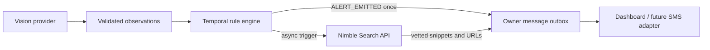
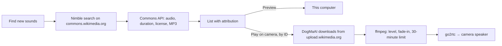

# Nimble in DogMaAI

DogMaAI uses Nimble in two places: to attach guidance when the monitoring engine confirms a situation, and, on request, to find new free-license sounds for the dog. In both, the API key stays on the server and never reaches the browser.

## Alert guidance

The deterministic engine remains responsible for the alert decision; web research cannot create, delay, or suppress an alert.



When `ALERT_EMITTED` appears, `SessionRuntime` immediately creates an in-app owner notification. `NimbleSafetyResearchProvider` searches only `aspca.org`, `vcahospitals.com`, `akc.org` and `humanesociety.org`, requests up to three lightweight results, and attaches the returned summary and links to that notification.

If `NIMBLE_API_KEY` (or the existing `NIMBLE_API` alias) is absent, the same flow uses a labeled `demo_fallback` provider with preselected ASPCA, VCA and AKC links. If a configured live lookup fails, the message still asks the owner to check on their dog and reports that guidance was unavailable.

```bash
cp .env.example .env
# Set NIMBLE_API_KEY in .env
npm run dev
```

In the kennel clip, **Restless while alone** crosses its threshold at 12 seconds. The manager shows the message as an in-app alert in **Activity**, marked **Nimble**, with clickable sources. The recurrence at 26 seconds resolves at 30 seconds, before its threshold, so it adds no message; repeated observations do not duplicate the message.

## Find new sounds



`createSoundFinder` picks a search for the time of day (gentle classical in the morning, soft rock or reggae in the afternoon, calm classical in the evening, slow piano or ambient music at night) and asks Nimble for pages on `commons.wikimedia.org` only. File pages are used directly, and up to three category pages, which are most of what Nimble returns, are expanded into up to 20 files each; catch-alls such as *Audio files* are skipped. When nothing playable turns up, Commons' own search for the same words is used, and the message says so. The file query must ask for `size`, or Commons leaves out durations. The Commons API then keeps audio between one minute and three hours, licensed public domain, CC0, CC BY or CC BY-SA, without extra restrictions, and prefers each file's MP3 so every browser can preview it.

Only recordings from recent searches can be played on the camera, looked up by an ID the server issued, so a page cannot make the camera play another address. The download is limited to `upload.wikimedia.org`, and ffmpeg only decodes the bytes it is given. See [MANAGER_SETUP.md](MANAGER_SETUP.md#nimble-new-sounds-and-alert-guidance) for the schedule and its research basis.

## Extension point

The current delivery adapter is `in_app_demo`, which makes the complete flow visible without collecting personal contact details. A production transport can consume the same `OwnerNotification` object and deliver it through SMS, push, or email. A useful next Nimble feature would be pet food and toy recall lookups when the owner names a product; that is more defensible than open-ended behavioral diagnosis.
